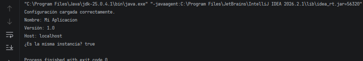

# Ejercicio 1: Configuración Inicial de la Aplicación

## Descripción

Este ejercicio implementa el patrón de diseño **Singleton** en Java para administrar la configuración inicial de una aplicación.

El objetivo es garantizar que exista una única instancia de la clase `AppConfig`, responsable de cargar y consultar 
las propiedades definidas en el archivo `config.properties`.

## Objetivos

- Aplicar el patrón de diseño Singleton.
- Restringir la creación de instancias mediante un constructor privado.
- Proporcionar un método público y estático para acceder a la instancia única.
- Cargar propiedades desde un archivo externo.
- Consultar parámetros de configuración mediante claves.
- Verificar que distintas referencias apunten al mismo objeto.

## Implementación del patrón Singleton

La clase `AppConfig` implementa el patrón Singleton mediante los siguientes elementos:

- **Instancia estática:** almacena la referencia al único objeto.
- **Constructor privado:** impide crear objetos directamente desde otras clases.
- **Método `getInstance()`:** permite obtener la instancia única.
- **Método `loadConfiguration()`:** carga las propiedades del archivo.
- **Método `getProperty(String key)`:** permite consultar una propiedad por su clave.
- **Método sincronizado:** evita que varios hilos creen instancias simultáneamente mediante `getInstance()`.

La instancia se crea de forma perezosa (*Lazy Initialization*), es decir, cuando se solicita por primera vez.

## EjecuciónAbrir el proyecto en IntelliJ IDEA.

1. Verificar que `config.properties` esté en la raíz del proyecto.
2. Abrir `Main.java`.
3. Ejecutar el método `main()`.
4. Comprobar los resultados en la consola.

## Resultado esperado

## Conclusión

El ejercicio demuestra cómo el patrón Singleton permite centralizar la configuración de una aplicación y compartir una única instancia entre sus componentes.

La comprobación `config1 == config2` devuelve `true`, confirmando que ambas variables hacen referencia al mismo objeto.
